# Эйрамор: Пепел Звёзд

3D-RPG от третьего лица о магии, расколотой звезде и большом открытом острове. Работает в браузере (Three.js), вся графика, музыка и звуки создаются процедурно — без внешних ассетов.

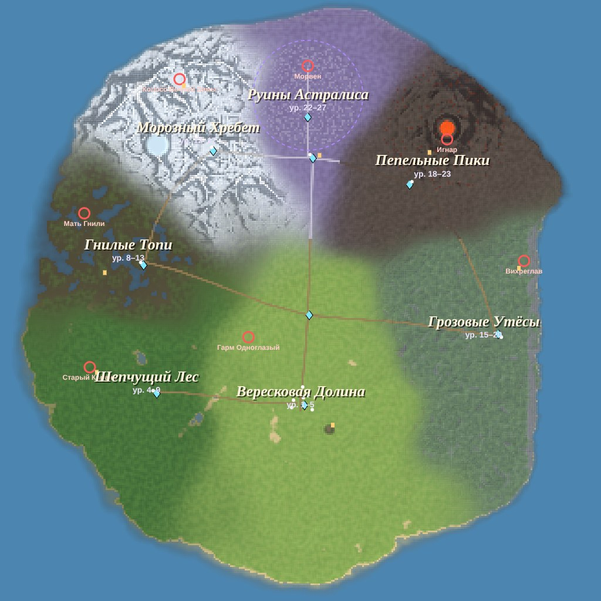

## Запуск

```bash
cd game
npm install
npm run dev        # http://localhost:5173
npm run build      # сборка в game/dist (открывается с любого статического хостинга)
npm run preview    # просмотр сборки
```

Нужен браузер с WebGL 2 (Chrome, Edge, Firefox, Safari). Управление — клавиатура и мышь, геймпад или сенсорный экран.

## Что внутри

- **Большой остров ~1,6 × 1,6 км** с семью регионами: Вересковая Долина, Шепчущий Лес, Гнилые Топи, Морозный Хребет, Грозовые Утёсы, Пепельные Пики (вулкан с лавой) и Руины Астралиса под Эфирным Куполом. Дороги, 10 путевых камней, деревни, маяк, руины, ~30 тыс. деревьев и камней, ~600 узлов сбора трав, смена дня и ночи, погода по регионам, туман войны на карте.
- **Камера от третьего лица** за плечом, перекат с неуязвимостью, бег, прыжки, плавание, мягкий захват цели.
- **Магия:** 5 школ (Пламя, Иней, Буря, Жизнь, Тень) × 5 навыков × 5 рангов, три круга, мастерство школ до 10 кругов, базовая атака, статусы (горение, яд, холод, заморозка, оглушение, корни, электризация, проклятие, слабость), призыв союзника.
- **Прокачка:** 30 уровней, 5 атрибутов, 5 предысторий, Великие Осколки с постоянными бонусами, свиток сброса.
- **Снаряжение:** 7 слотов, 5 редкостей, 26 аффиксов с согласованием рода в названиях, 9 уникальных легендарок, улучшение у кузнеца до +5, разбор на звёздный пепел, алхимия, 4 торговца.
- **Враги:** 21 вид и 7 хранителей-боссов с фазами и телеграфированными способностями, элиты с префиксами, лагеря с возрождением.
- **Сюжет:** 3 акта, 11 сюжетных и 12 побочных квестов, 12 NPC с ветвящимися диалогами, 7 скрижалей лора, поворот сюжета и 3 финала.
- **Интерфейс:** HUD, миникарта, маркер цели, трекер квестов, книга героя (персонаж, сумка, навыки, журнал, карта с быстрыми путешествиями), подсказки со сравнением предметов, настройки, автосохранение.

## Документация

| Документ | О чём |
|---|---|
| [docs/LORE.md](docs/LORE.md) | Библия мира: космология, история, фракции, персонажи, регионы, бестиарий |
| [docs/STORY.md](docs/STORY.md) | Сюжет по актам, все квесты, поворот, финалы |
| [docs/MECHANICS.md](docs/MECHANICS.md) | Управление, формулы, навыки, предметы, экономика, таблицы баланса |

Навыки Claude для дальнейшей работы над игрой лежат в `../.claude/skills/`: `lore-architect`, `quest-designer`, `dialogue-writer`, `rpg-balance`, `world-builder`.

## Устройство кода

```
src/
  config.js           балансные константы
  game.js             загрузка, состояния, цикл, сохранения, взаимодействие
  core/               ввод, звук (Web Audio), события, хранилище, ГСЧ и шум
  data/               контент: регионы, локации, враги, предметы, навыки, квесты, диалоги, лор, NPC
  world/              рельеф, декорации, постройки, коллизии, небо/вода/купол, объекты
  entities/           игрок, камера, враги и лагеря, NPC, процедурные модели
  systems/            бой, статусы, заклинания, снаряды и зоны, предметы, инвентарь, квесты, диалоги, лут, торговля
  fx/                 частицы, эффекты, погода
  ui/                 HUD, меню, карта, иконки, сенсорное управление, стили
tools/                автотесты и утилиты (Playwright + headless Chromium)
```

## Тесты

При запущенном `npm run dev`:

```bash
node tools/smoke-test.mjs    # создание героя, бой, диалог, меню, торговля, регионы, сохранение, смерть
node tools/quest-test.mjs    # весь сюжет от первого диалога до финала
node tools/mobile-shot.mjs   # мобильная раскладка с сенсорным управлением
node tools/balance.mjs       # таблицы баланса
node tools/export-map.mjs    # обновить docs/map.jpg
```

## Скриншоты

| | |
|---|---|
| 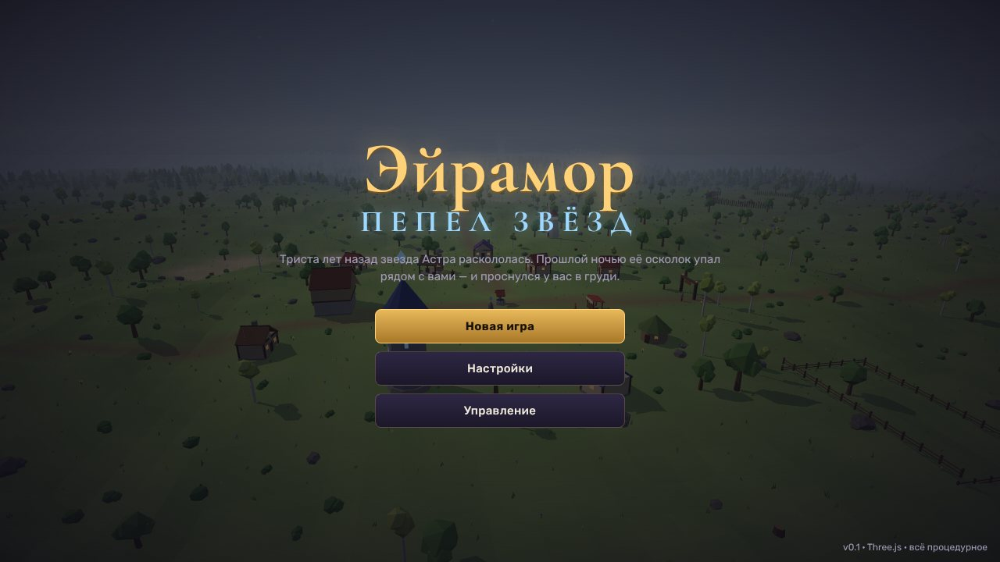 | 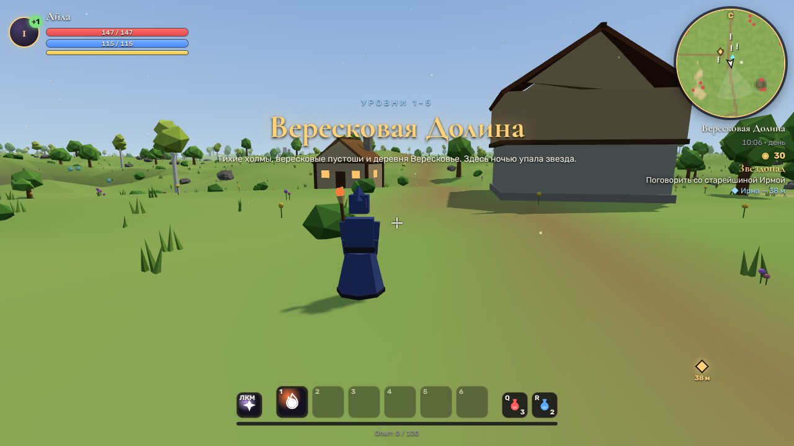 |
| 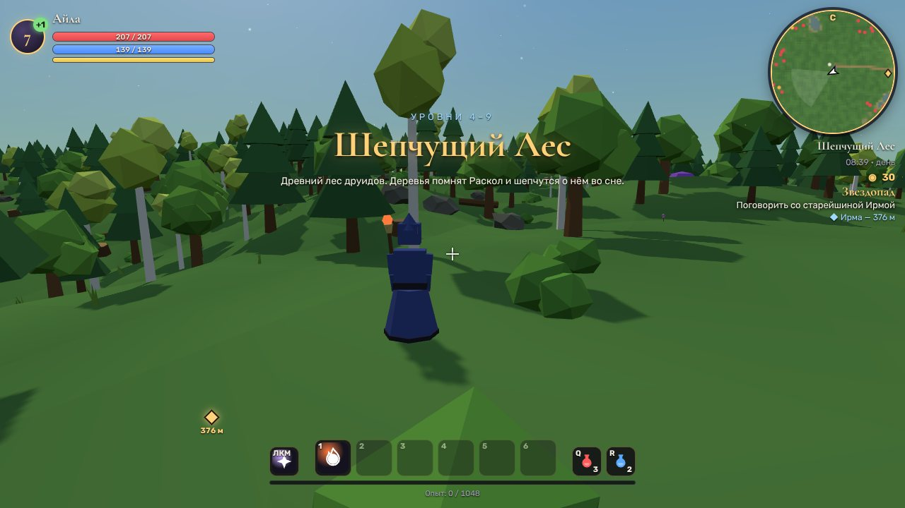 | 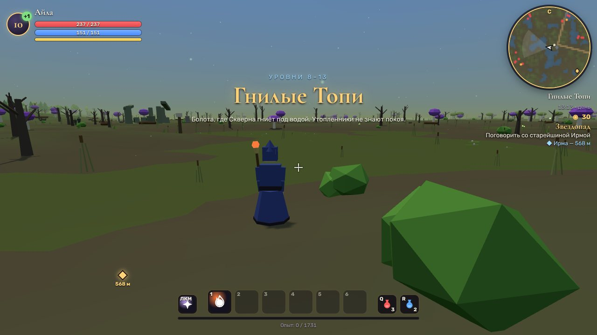 |
| 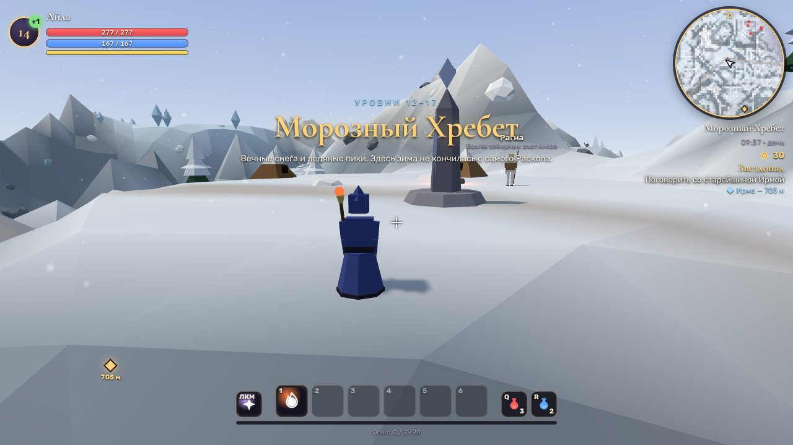 | 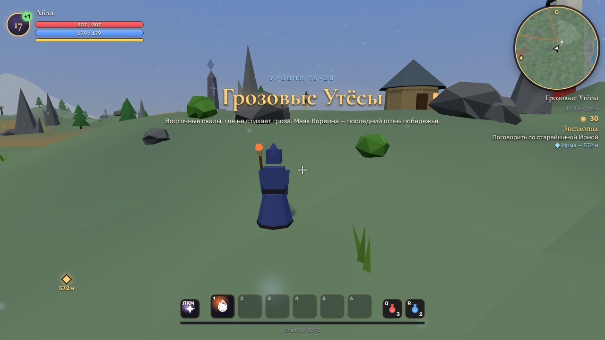 |
| 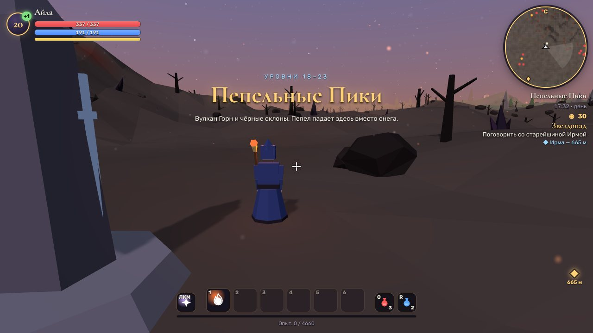 | 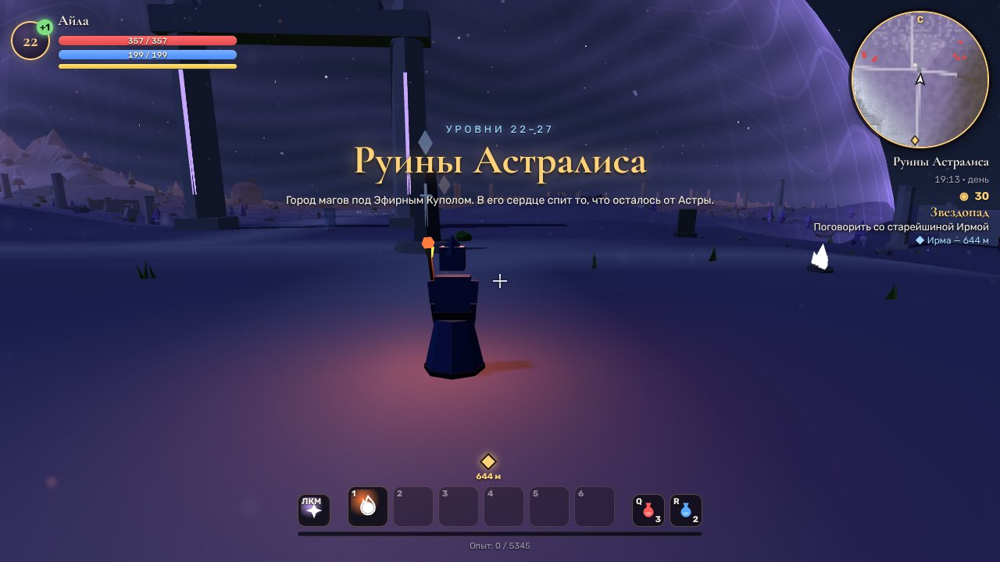 |
| 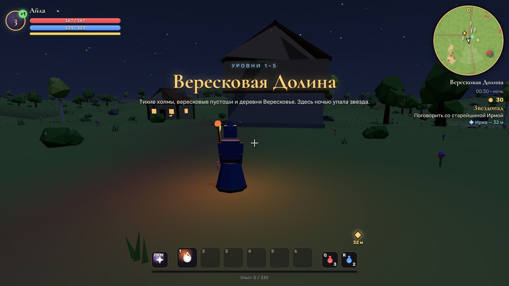 | 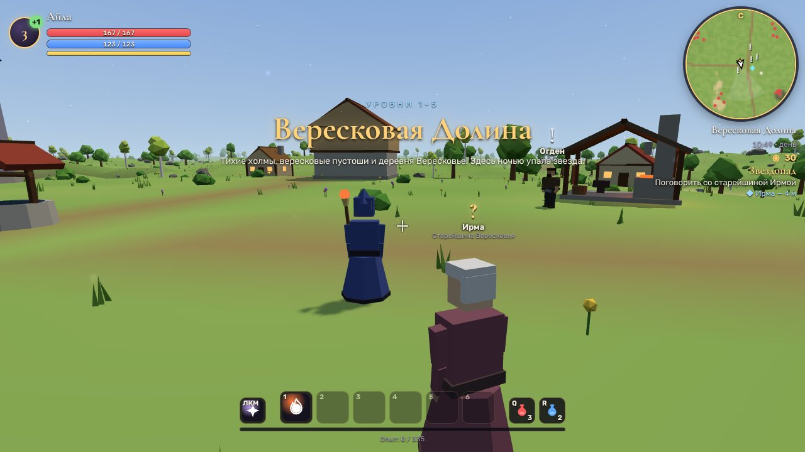 |
| 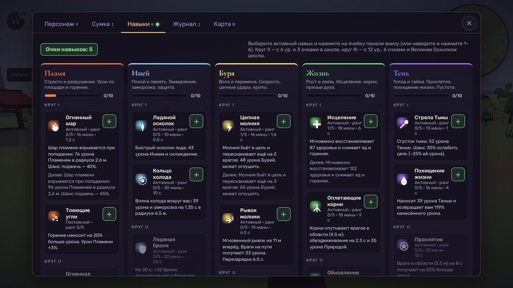 | 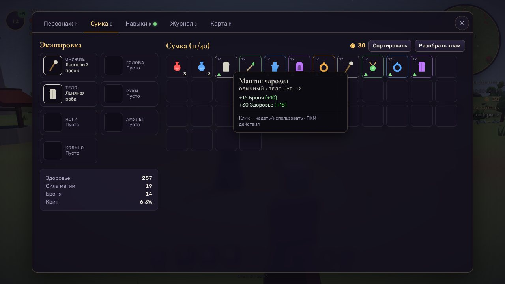 |
